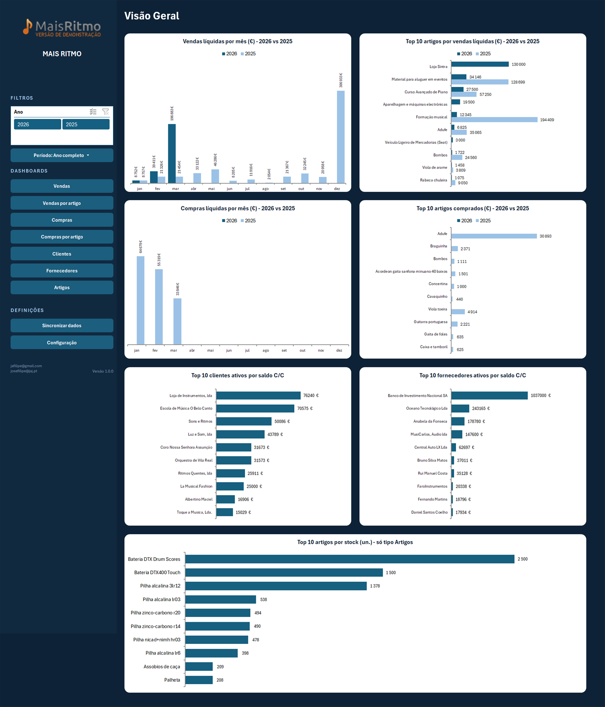

# aERP — Business Intelligence em Excel para PHC

> Dashboards, consultas e comparações anuais sobre os dados do ERP **PHC**, dentro do Excel, sem o utilizador precisar de saber Power Pivot nem SQL.

O **aERP** liga-se à base de dados SQL Server do PHC, carrega os dados de vendas, compras, clientes, fornecedores e artigos num modelo **Power Pivot** e apresenta-os em **dashboards interativos**, **folhas de consulta** e **comparações anuais** ao estilo do PHC. O utilizador configura a ligação uma vez, carrega em **Sincronizar dados** e trabalha só com botões e filtros.

*Resumo do aERP: visão geral das vendas, compras, clientes, fornecedores e stock, com filtro de Ano e Período e acesso a todos os dashboards.*

---

## O que faz

- **Liga-se ao PHC** (SQL Server) e traz as tabelas de movimentos e fichas para um modelo Power Pivot, sem o utilizador escrever SQL.
- **7 dashboards** com o mesmo aspeto (Vendas, Vendas por Artigo, Compras, Compras por Artigo, Clientes, Fornecedores, Artigos): KPIs, gráficos por mês, tops 10, margem bruta, distribuição por distrito/concelho/país e por tipo, vendedor ou família.
- **Comparação de anos**: escolhe um ou dois anos e todos os gráficos passam a comparar (barras com duas séries, donuts com dois anéis, títulos "2026 vs 2025"); o ano escolhido é sincronizado entre todas as folhas.
- **Período**: analisar o ano completo, até ao mês atual, até ao fim do mês, um trimestre ou um semestre; as comparações e os títulos acompanham o período escolhido.
- **Cartões de indicadores do ano mais recente**: nos dashboards de Vendas, Vendas por Artigo, Compras e Compras por Artigo, os cartões no topo e o título mostram o ano mais recente escolhido, enquanto os gráficos comparam os dois anos.
- **Comparação anual ao estilo PHC**: tabela mês a mês com acumulados, desvios em valor e em %, rentabilidade e setas ▲▼, com detalhe por cliente, fornecedor ou artigo.
- **Folhas de consulta**: uma lista completa por tabela, com os mesmos filtros do dashboard, criada só quando é aberta (para a sincronização ser rápida), e **Ordenar por** qualquer coluna, de A a Z ou de Z a A, com regresso à ordem original.
- **Filtros fáceis**: segmentações compactas para campos pequenos e botões de lista com pesquisa e escolha múltipla para campos grandes; campos sem dados escondem-se sozinhos.
- **Nome e logótipo da empresa** lidos automaticamente do próprio PHC.
- **Pronto a instalar**: um instalador regista o suplemento, cria o local fidedigno das macros e copia tudo para a pasta do utilizador sem precisar de administrador. Se faltar o driver de ligação ao SQL Server, instala-o também.

---

## Descarregar

Os ficheiros para experimentar estão na pasta **[`downloads/`](downloads)**:

- **[`aERP_Setup_1.0.0.zip`](downloads/aERP_Setup_1.0.0.zip)** (14,9 MB): instalador do aERP (livro + suplemento + lista de códigos postais + Microsoft OLE DB Driver 18 para SQL Server).
- **[`Microsoft OLE DB para SQL Server 18.7.6.zip`](downloads/Microsoft%20OLE%20DB%20para%20SQL%20Server%2018.7.6.zip)** (8,7 MB): o mesmo driver, para instalar à parte se for preciso.
- **[`Video aERP.mp4`](downloads/Video%20aERP.mp4)** (89,7 MB): vídeo explicativo que percorre as principais funcionalidades.

Para descarregar, abra o ficheiro e carregue em **Download raw file** (ícone ⤓).

**Instalar:** descarregue o `aERP_Setup_1.0.0.zip`, extraia-o (botão direito > **Extrair tudo**) e execute o `aERP_Setup_1.0.0.exe`.

> **Driver de ligação ao SQL Server:** o aERP liga-se ao PHC através do **Microsoft OLE DB Driver 18 para SQL Server**. Se este driver não estiver instalado, o teste de ligação dá o erro *"3706 - Não foi encontrado o fornecedor"*. O instalador verifica-o e, se faltar, instala-o no fim (versão de 64 bits, que inclui também a de 32 bits, ou de 32 bits num Windows de 32 bits). Só neste passo o Windows pede autorização de administrador. Se o computador não tiver permissões de administrador, peça ao responsável informático para instalar o driver (ficheiro `.zip` acima).

> Dados sensíveis (servidor, base de dados, credenciais) são de demonstração nos materiais publicados.

---

## Como funciona

1. Indica-se o servidor e a base de dados do PHC e carrega-se em **Guardar**. O nome e o logótipo da empresa são lidos do PHC.
2. Em **Sincronizar dados**, o aERP lê do PHC as vendas, compras, clientes, fornecedores e artigos e carrega-os no modelo de dados do Excel.
3. Os dashboards, as consultas e as comparações atualizam-se sozinhos, já com os dois anos mais recentes escolhidos.

---

## Requisitos

- Windows com **Excel 365 / 2021 de 64 bits** (com Power Pivot).
- **Microsoft OLE DB Driver 18 para SQL Server** (instalado pelo `aERP_Setup` se faltar).
- Acesso de rede ao **SQL Server do PHC**.
- Ligação à Internet.

---

## Documentação

- [`docs/aERP_visao_geral.md`](docs/aERP_visao_geral.md) — visão geral: como funciona, dados disponíveis, funcionalidades, instalação e tecnologias.

---

## Tecnologias

Power Pivot (modelo, DAX) · Power Query (M) · funções CUBE e segmentações OLAP · VBA (formulários, ADO, eventos de livro) · SQL Server (PHC) · Inno Setup (instalador).

---

_Todos os direitos reservados._
